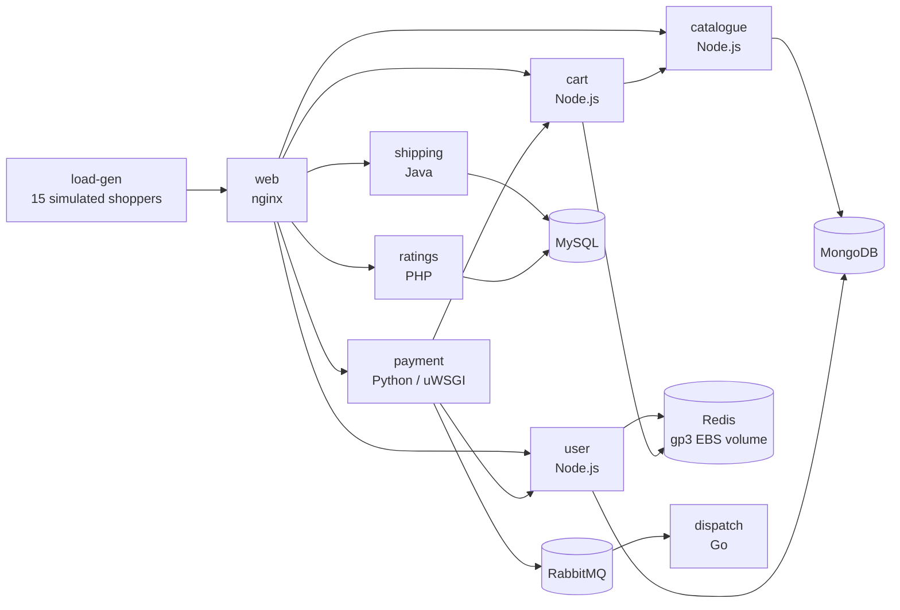
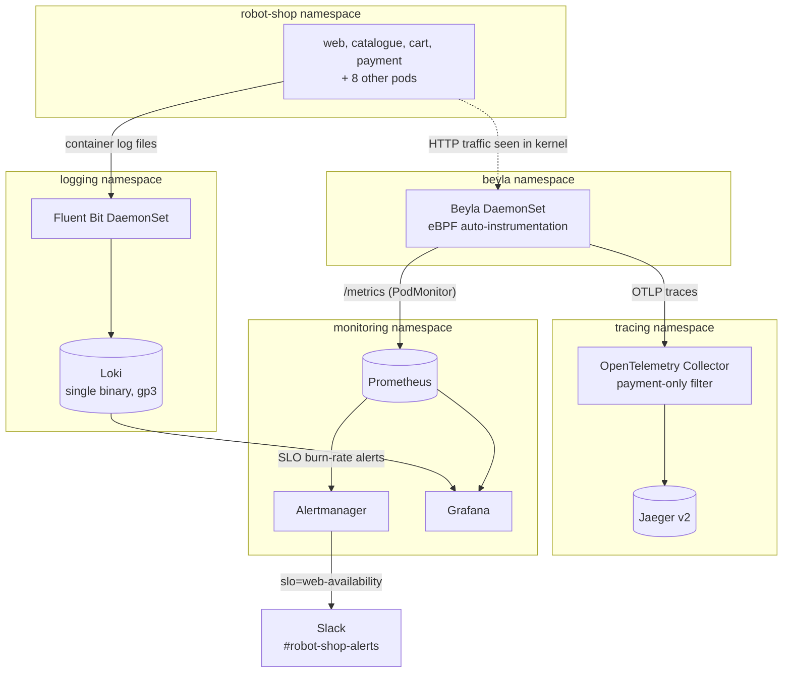
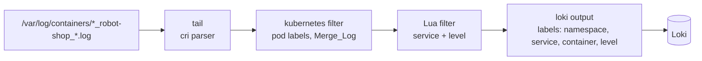
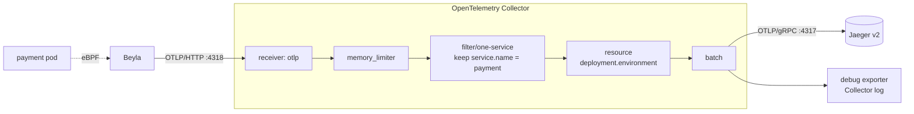

# Capstone 2: Operating Stan's Robot Shop on EKS

**Observability, SLOs and incident response for a 12-service microservices shop**

This repository is a fork of [instana/robot-shop](https://github.com/instana/robot-shop). The application code is unchanged. What this fork adds is everything needed to **run, observe and operate** it on the Amazon EKS cluster built in Capstone 1 ([AKPOCHI/example-voting-app](https://github.com/AKPOCHI/example-voting-app)): Kubernetes changes, metrics, logs, traces, an SLO with alerting, and an incident process.

| Step | Brief | Status |
|---|---|---|
| 1 | Deploy and watch: install Robot Shop, start load-gen, all pods healthy | ✅ Done |
| 2 | See the metrics: kube-prometheus-stack + one dashboard for requests, errors and latency | ✅ Done |
| 3 | Collect the logs: Fluent Bit to Loki, searchable by service and error level | ✅ Done |
| 4 | Follow one trace: OpenTelemetry config on one service, one trace found in Jaeger | ✅ Done |
| 5 | Set one SLO: availability, one-page error budget policy, one alert to Slack | 🟡 SLO, alerts and policy done; Slack webhook still to be connected |
| 6 | Run the incident drill: mitigate, find the root cause, write a postmortem | 🟡 Runbook, triage script and template ready; drill pending |

**Focus services:** `web`, `catalogue`, `cart`, `payment`. **Data stores:** MongoDB, Redis, MySQL, RabbitMQ. The other services (user, shipping, ratings, dispatch) only need to run.

---

## Contents

1. [Architecture](#1-architecture)
2. [Platform](#2-platform)
3. [Repository layout](#3-repository-layout)
4. [Step 1: Deploy and watch](#4-step-1-deploy-and-watch)
5. [Step 2: Metrics](#5-step-2-metrics)
6. [Step 3: Logs](#6-step-3-logs)
7. [Step 4: Tracing](#7-step-4-tracing)
8. [Step 5: SLO and alerting](#8-step-5-slo-and-alerting)
9. [Step 6: Incident drill](#9-step-6-incident-drill)
10. [Rebuild from scratch](#10-rebuild-from-scratch)
11. [Cleanup](#11-cleanup)
12. [Problems solved](#12-problems-solved)
13. [Known limitations and trade-offs](#13-known-limitations-and-trade-offs)
14. [Versions](#14-versions)

---

## 1. Architecture

### Application



### Observability stack



| Signal | Collected by | Stored in | Viewed in |
|---|---|---|---|
| Metrics (RED) | Beyla (eBPF) | Prometheus | Grafana: *Robot Shop - Requests, Errors, Latency* |
| Kubernetes metrics | kube-state-metrics, node-exporter | Prometheus | Grafana: built-in Kubernetes dashboards |
| Logs | Fluent Bit | Loki | Grafana: *Robot Shop - Logs*, Explore |
| Traces | Beyla → OpenTelemetry Collector | Jaeger | Jaeger UI |
| Alerts | Prometheus rules | Alertmanager | Slack, Alertmanager UI |

---

## 2. Platform

Robot Shop runs on the **Capstone 1 cluster**. That cluster's Terraform lives in the example-voting-app repo.

| Item | Value |
|---|---|
| Cloud / region | AWS `eu-north-1` (the only region the account's SCP allows) |
| Cluster | EKS `voting-app`, Kubernetes **1.37** |
| Nodes | 2 × `m7i-flex.large` (2 vCPU, 8 GiB) in private subnets, egress through one NAT gateway |
| Storage | EBS CSI driver (EKS add-on, credentials through **EKS Pod Identity**, because the SCP blocks OIDC providers) |
| Infrastructure as code | Terraform, remote state in S3 with native lock files; `terraform apply` creates **33 resources** |

The one cluster-level addition for Robot Shop is a **gp3 StorageClass** (`K8s/storageclass-gp3.yaml`), which the EBS CSI driver provisions. Redis and Loki use it for persistent volumes.

---

## 3. Repository layout

Only files added or changed for the capstone are listed.

```
robot-shop/
├── README.md                          # this file
├── K8s/
│   ├── storageclass-gp3.yaml          # Step 1: gp3 EBS StorageClass (encrypted, WaitForFirstConsumer)
│   ├── load-deployment.yaml           # Step 1: load-gen, memory limit raised to 512Mi
│   ├── helm/                          # Step 1: the provided chart, Instana settings removed
│   │   ├── values.yaml                #   nodeport: true, redis storageClassName: gp3
│   │   └── templates/
│   │       ├── *-deployment.yaml      #   INSTANA_AGENT_HOST removed (cart, catalogue, dispatch, payment, user)
│   │       ├── web-deployment.yaml    #   Instana EUM block removed
│   │       └── shipping-deployment.yaml #   limits raised to 1000m CPU / 1500Mi
│   ├── monitoring/                    # Step 2 (+ Steps 3 and 5)
│   │   ├── kps-values.yaml            #   kube-prometheus-stack values (EKS tuning, Loki datasource, Slack routing)
│   │   ├── beyla.yaml                 #   Beyla DaemonSet, RBAC, config, PodMonitor, OTLP trace export
│   │   └── robot-shop-red.json        #   RED dashboard (as code)
│   ├── logging/                       # Step 3
│   │   ├── loki-values.yaml           #   Loki single binary on gp3
│   │   ├── fluent-bit-values.yaml     #   tail -> kubernetes -> Lua (service + level) -> Loki
│   │   └── robot-shop-logs.json       #   Logs dashboard (as code)
│   ├── tracing/                       # Step 4
│   │   ├── otel-collector.yaml        #   OpenTelemetry Collector config + Deployment
│   │   └── jaeger.yaml                #   Jaeger v2 all-in-one
│   └── slo/                           # Step 5
│       └── web-availability-slo.yaml  #   SLI recording rules + burn-rate alerts
├── docs/
│   ├── slo/error-budget-policy.md     # Step 5: one-page error budget policy
│   └── incident/                      # Step 6
│       ├── runbook.md
│       ├── postmortem-template.md
│       └── postmortem-*.md            #   written after each drill
└── scripts/
    └── triage.ps1                     # Step 6: first-5-minutes incident snapshot
```

**No secrets are stored in git.** The Grafana admin password and the Slack webhook URL are created as Kubernetes Secrets from the command line (see [Rebuild from scratch](#10-rebuild-from-scratch)).

---

## 4. Step 1: Deploy and watch

**Goal:** install Robot Shop on the Capstone 1 cluster with the provided Helm chart, start load-gen, and get every pod healthy.

### Changes to the provided chart

| Change | Why |
|---|---|
| Removed the `INSTANA_AGENT_HOST` environment variable from 5 deployments | There's no Instana agent in this cluster |
| Removed the Instana **EUM** (end-user monitoring) block from `web` and the `eum:` section of `values.yaml` | Same reason |
| `nodeport: true` | `web` is reached through `kubectl port-forward`. A `LoadBalancer` would create a paid AWS load balancer that isn't needed |
| Redis `storageClassName: standard` → `gp3` | `standard` doesn't exist on EKS. Redis's PersistentVolumeClaim is now backed by an encrypted gp3 EBS volume |
| load-gen memory limit 200Mi → **512Mi** | It was `OOMKilled` 9 times in 47 minutes. Locust with 15 clients needs more than 200Mi |
| shipping limits 200m CPU / 1000Mi → **1000m / 1500Mi** | Java `OutOfMemoryError: GC overhead limit exceeded`, `OOMKilled`, and 3,247 failed readiness checks because the CPU limit starved the garbage collector |

### Install

```powershell
kubectl apply -f K8s\storageclass-gp3.yaml
helm install robot-shop K8s\helm --namespace robot-shop --create-namespace --wait --timeout 10m
kubectl apply -f K8s\load-deployment.yaml -n robot-shop
kubectl get pods,pvc -n robot-shop
```

**Result:** 13 pods `Running` (12 services plus load-gen), with restart counts stable, and `data-redis-0` `Bound` to a gp3 volume.

```powershell
kubectl -n robot-shop port-forward svc/web 8080:8080    # then open http://localhost:8080
```

---

## 5. Step 2: Metrics

**Goal:** install kube-prometheus-stack with Helm and build one dashboard for requests, errors and latency (RED).

### The problem: Robot Shop doesn't publish request metrics

kube-prometheus-stack provides Prometheus, Grafana and metrics *about Kubernetes*, but Robot Shop's services don't expose request counts or response times. The options were adding Prometheus client libraries to four codebases in three languages and rebuilding the images, or **eBPF auto-instrumentation**.

**Decision: [Grafana Beyla](https://grafana.com/docs/beyla/)** (v3.27, built on OpenTelemetry eBPF Instrumentation). It runs as a DaemonSet, watches HTTP traffic in the kernel, and publishes `http_server_request_duration_seconds` (a histogram labelled with deployment, method, route and status code) **without any code or image changes**. It works the same way for nginx, Node.js and Python/uWSGI. It's restricted to the four focus services.

### kube-prometheus-stack tuning for EKS (`K8s/monitoring/kps-values.yaml`)

- `kubeControllerManager`, `kubeScheduler`, `kubeEtcd` and `kubeProxy` scraping are **disabled**. EKS manages the control plane, so these targets would only ever be "down" and fire false alerts.
- `*SelectorNilUsesHelmValues: false`, so Prometheus picks up PodMonitors and PrometheusRules from any namespace (needed for Beyla and the SLO rules).
- Retention is 2 days with in-memory storage: nothing is billed and nothing is left behind after cleanup.
- The Grafana admin login comes from a Secret created outside git.

### The RED dashboard (`K8s/monitoring/robot-shop-red.json`)

The dashboard is kept as code. It's loaded through a ConfigMap labelled `grafana_dashboard=1` and picked up by Grafana's sidecar, so rebuilding the cluster brings it back automatically.

| Row | Panels |
|---|---|
| Top | Requests/sec · Error rate (5xx) % · p95 latency |
| Middle | Requests/sec by service |
| Bottom | Error % by service · p50/p95/p99 latency by service · requests by HTTP status |

There's a **Service** drop-down for web, catalogue, cart and payment.

**What it showed:** about 19 req/s in total, following a normal shopping funnel (web 12.8 > catalogue 4.3 > cart 3.9 > payment 1.3 req/s). Payment returned **about 49% 5xx** (load-gen runs with `ERROR=1`, which deliberately fails payments) and web about 5%. Typical p50 latency was 2 to 8 ms. Payment's p95 was about 640 ms, because it calls an external payment gateway.

---

## 6. Step 3: Logs

**Goal:** run Fluent Bit and send logs to Loki, searchable by **service** and **error level**.



### Working out the log level

Each service logs in its own format, so a Lua script in Fluent Bit (`K8s/logging/fluent-bit-values.yaml`) works out `level` for each line:

| Format | Services | Rule |
|---|---|---|
| JSON (pino), numeric `level` | cart, catalogue, user | 30 → info, 40 → warn, 50/60 → error |
| nginx access log | web | HTTP status: 5xx → error, 4xx → warn, otherwise info |
| Plain text | payment, shipping, ratings, others | Looks for `ERROR` / `WARN` / `DEBUG` / `EXCEPTION` in the text, otherwise info |

`service` comes from each pod's own `service:` label (for example `service: cart`).

### Loki (`K8s/logging/loki-values.yaml`)

Loki runs as a **single binary** with filesystem storage on a **5 GiB gp3 volume**. The chart's **memcached caches are turned off**: by default they request several GiB of memory, which wouldn't fit on the nodes. The gateway, canary and test pods are also off. Grafana reaches Loki through an extra data source (`uid: loki`) configured in `kps-values.yaml`.

### Searching

The *Robot Shop - Logs* dashboard (`K8s/logging/robot-shop-logs.json`) has **Service** and **Level** drop-downs, a free-text search box, a log-rate-by-level graph, and an error-lines-by-service chart. In Explore:

```logql
{service="payment", level="error"}
{service="cart"} | json | level="warn"
sum by (service) (count_over_time({namespace="robot-shop", level="error"}[5m]))
```

**Result:** Loki receives labels for 10 services and three levels (`error`, `info`, `warn`), at about 50 info lines/s and about 4 error lines/s.

---

## 7. Step 4: Tracing

**Goal:** apply an OpenTelemetry config to one service and find one trace in Jaeger.

The instructor's config wasn't available, so **`K8s/tracing/otel-collector.yaml` is the project's own equivalent**, using the standard Collector layout.



| Collector section | Purpose |
|---|---|
| `receivers.otlp` | Accepts OTLP over gRPC (4317) and HTTP (4318) |
| `processors.memory_limiter` | Starts refusing data before the Collector runs out of memory |
| `processors.filter/one-service` | **The "one service" rule:** drops spans whose `service.name` isn't `payment` |
| `processors.resource` | Tags every span with `deployment.environment=capstone-eks` |
| `processors.batch` | Sends spans in batches |
| `exporters.otlp_grpc/jaeger` | Sends to Jaeger |
| `exporters.debug` | Logs a one-line summary per batch, so you can confirm spans are flowing |

**Why payment:** it's the slowest service (p95 about 640 ms) and the most error-prone, so its traces show where the time goes and which call fails.

**Why Beyla rather than the OpenTelemetry SDK inside payment:** payment runs under uWSGI, whose pre-forking model is a known way to lose the Python SDK's background export thread. Instrumenting it in-app would also have meant rebuilding a legacy image. Beyla produces standard OpenTelemetry spans without either problem.

**Finding a trace:** `kubectl -n tracing port-forward svc/jaeger 16686:16686`, open `http://localhost:16686`, choose Service **payment**, click **Find Traces**, and open one. Each trace shows payment's server span (`POST /pay/{id}`) with client spans for its outgoing calls.

---

## 8. Step 5: SLO and alerting

**Goal:** pick availability, write a one-page error budget policy, and send one alert to Slack.

### The SLO

| | |
|---|---|
| **Service** | `web`, the front door every user request passes through |
| **SLI** | Share of `web` requests that don't return 5xx (from Beyla's metric) |
| **SLO** | **99.5%** over a rolling 30 days |
| **Error budget** | 0.5%: about **166,000 failed requests** a month at about 12.8 req/s, or about **3.6 hours** of total outage |

### Multi-window, multi-burn-rate alerts (`K8s/slo/web-availability-slo.yaml`)

The recording rules compute `slo:web_error_ratio:rate{5m,30m,1h,6h}`. The alerts follow the Google SRE Workbook pattern:

| Alert | Fires when | Budget exhausted in | Severity |
|---|---|---|---|
| `WebAvailabilityFastBurn` | Error ratio above **7.2%** (14.4×) over 1h **and** 5m, for 2 minutes | about 2 days | critical (page) |
| `WebAvailabilitySlowBurn` | Error ratio above **3%** (6×) over 6h **and** 30m, for 15 minutes | about 5 days | warning (ticket) |

The short window makes each alert **resolve quickly** once the problem stops.

### Slack routing (`kps-values.yaml`, `alertmanager.config`)

- The default route goes to a `null` receiver. kube-prometheus-stack ships about 100 built-in alerts, including **Watchdog**, which is always firing by design, so sending everything to Slack would flood the channel.
- Only alerts labelled `slo="web-availability"` go to `slack-slo`, with `send_resolved: true`.
- The webhook URL is read from a **mounted Secret** (`api_url_file`) and never appears in git.

### Error budget policy

[`docs/slo/error-budget-policy.md`](docs/slo/error-budget-policy.md) sets out four states based on how much budget is left (normal, caution, restricted, freeze), a postmortem rule (any incident using more than 20% of the budget), exclusions, and the known caveats of this demo environment.

### Status

The SLO, the rules and the policy are deployed. Alertmanager currently runs with a **placeholder** webhook Secret. To finish this step, create the Slack Incoming Webhook, replace the Secret, then run a controlled outage (scale `catalogue` and `cart` to 0) to send `[FIRING]` and `[RESOLVED]` messages to `#robot-shop-alerts`.

---

## 9. Step 6: Incident drill

**Goal:** the instructor breaks something. Mitigate first, find the root cause, then write a postmortem.

| Asset | Purpose |
|---|---|
| [`docs/incident/runbook.md`](docs/incident/runbook.md) | Roles, the loop (detect → triage → mitigate → verify → root cause → postmortem), which tool answers which question, a table of common failures and their mitigations, communication templates |
| [`scripts/triage.ps1`](scripts/triage.ps1) | One command that captures firing alerts, the SLO error ratio, unhealthy pods, warning events, Helm and rollout history, and recent error logs for the focus services, without needing port-forwards |
| [`docs/incident/postmortem-template.md`](docs/incident/postmortem-template.md) | Blameless format: impact in error-budget terms, timeline, 5 whys, action items |

**Rehearsal drill:** cart's `REDIS_HOST` is pointed at a host that doesn't exist with `kubectl set env`, a manual change outside Helm ("configuration drift"). Mitigation is `kubectl rollout undo deployment/cart`. The root cause is found from the rollout history and from `{service="cart", level="error"}` in Loki.

---

## 10. Rebuild from scratch

Prerequisite: the Capstone 1 cluster is up (`terraform apply` in `example-voting-app/terraform`), and `kubectl` points at it.

```powershell
cd robot-shop

# Step 1: application
kubectl apply -f K8s\storageclass-gp3.yaml
helm install robot-shop K8s\helm -n robot-shop --create-namespace --wait --timeout 10m
kubectl apply -f K8s\load-deployment.yaml -n robot-shop

# Step 2: monitoring (secrets are created from the command line, never committed)
kubectl create namespace monitoring
$pw = -join ((48..57) + (65..90) + (97..122) | Get-Random -Count 20 | ForEach-Object { [char]$_ })
kubectl -n monitoring create secret generic grafana-admin --from-literal=admin-user=admin --from-literal=admin-password=$pw
$hook = Read-Host "Slack webhook URL"
kubectl -n monitoring create secret generic alertmanager-slack --from-literal=webhook-url=$hook
helm repo add prometheus-community https://prometheus-community.github.io/helm-charts
helm install kps prometheus-community/kube-prometheus-stack --version 92.11.0 -n monitoring -f K8s\monitoring\kps-values.yaml --wait --timeout 10m
kubectl apply -f K8s\monitoring\beyla.yaml
kubectl -n monitoring create configmap robot-shop-red-dashboard --from-file=robot-shop-red.json=K8s\monitoring\robot-shop-red.json
kubectl -n monitoring label configmap robot-shop-red-dashboard grafana_dashboard=1

# Step 3: logging
helm repo add grafana https://grafana.github.io/helm-charts
helm repo add fluent https://fluent.github.io/helm-charts
helm install loki grafana/loki --version 7.5.0 -n logging --create-namespace -f K8s\logging\loki-values.yaml --wait --timeout 10m
helm install fluent-bit fluent/fluent-bit --version 0.58.3 -n logging -f K8s\logging\fluent-bit-values.yaml --wait
kubectl -n monitoring create configmap robot-shop-logs-dashboard --from-file=robot-shop-logs.json=K8s\logging\robot-shop-logs.json
kubectl -n monitoring label configmap robot-shop-logs-dashboard grafana_dashboard=1

# Step 4: tracing
kubectl apply -f K8s\tracing\jaeger.yaml
kubectl apply -f K8s\tracing\otel-collector.yaml

# Step 5: SLO
kubectl apply -f K8s\slo\web-availability-slo.yaml
```

| UI | Command | URL |
|---|---|---|
| Robot Shop | `kubectl -n robot-shop port-forward svc/web 8080:8080` | http://localhost:8080 |
| Grafana | `kubectl -n monitoring port-forward svc/kps-grafana 3000:80` | http://localhost:3000 |
| Prometheus | `kubectl -n monitoring port-forward svc/kps-kube-prometheus-stack-prometheus 9090:9090` | http://localhost:9090 |
| Alertmanager | `kubectl -n monitoring port-forward svc/kps-kube-prometheus-stack-alertmanager 9093:9093` | http://localhost:9093 |
| Jaeger | `kubectl -n tracing port-forward svc/jaeger 16686:16686` | http://localhost:16686 |
| Loki API | `kubectl -n logging port-forward svc/loki 3100:3100` | http://localhost:3100/ready |

---

## 11. Cleanup

The order matters. **PersistentVolumeClaims must be deleted before `terraform destroy`.** Otherwise the EBS volumes behind them are orphaned and keep billing.

```powershell
kubectl delete -f K8s\tracing\otel-collector.yaml
kubectl delete -f K8s\tracing\jaeger.yaml
helm uninstall fluent-bit -n logging
helm uninstall loki -n logging
kubectl delete pvc -n logging --all
kubectl delete -f K8s\monitoring\beyla.yaml
helm uninstall kps -n monitoring
kubectl delete -f K8s\load-deployment.yaml -n robot-shop
helm uninstall robot-shop -n robot-shop
kubectl delete pvc -n robot-shop --all

cd ..\example-voting-app\terraform
terraform destroy        # expect: 33 destroyed
```

---

## 12. Problems solved

| # | Problem | Cause | Fix |
|---|---|---|---|
| 1 | load-gen restarted 9 times in 47 minutes | `OOMKilled` at its 200Mi limit | Raised the limit to 512Mi |
| 2 | shipping `0/1 Ready`, 3,247 failed readiness checks | Java heap exhaustion (`GC overhead limit exceeded`), and a 200m CPU limit starving the garbage collector | Raised limits to 1000m CPU / 1500Mi |
| 3 | No request metrics in Robot Shop | The services don't expose them | Beyla eBPF auto-instrumentation, with no code changes |
| 4 | Permanently "down" control-plane targets | EKS manages the control plane | Disabled those scrapes in `kps-values.yaml` |
| 5 | `helm install` failed: `PASTE_CHART_VERSION_HERE not found` | A placeholder was left in the command | Pinned 92.11.0. Later steps read the version automatically |
| 6 | `helm install ... unexpected arguments: logging` | The version lookup returned empty, so `--version` swallowed `--namespace` | Parsed the version from `helm search repo`'s text output |
| 7 | `no matches for kind "PodMonitor"` | Applied before kube-prometheus-stack had installed the CRD | Re-applied after the stack was installed |
| 8 | Loki would have needed several GiB of RAM | The chart's default memcached caches | Disabled `chunksCache` and `resultsCache` |
| 9 | `[IO.File]` edits went to the wrong folder | .NET's working directory doesn't follow PowerShell's `cd` | Set `[Environment]::CurrentDirectory` before editing |
| 10 | Beyla edit inserted twice, breaking the PodMonitor YAML | The regex matched `path: /metrics` in two places | Removed the second insertion, and checked the match count before applying |
| 11 | Collector warning: `"otlp" alias is deprecated` | The exporter name was renamed upstream | Renamed it to `otlp_grpc/jaeger` |
| 12 | Built-in alerts (Watchdog) would flood Slack | kube-prometheus-stack ships about 100 alerts | Default route to `null`; only `slo="web-availability"` alerts go to Slack |
| 13 | Alertmanager stuck in `Pending` | The `alertmanager-slack` Secret didn't exist yet | Created a placeholder Secret, to be replaced with the real webhook |
| 14 | Intermittent `no such host` for the EKS endpoint | Unreliable local DNS | Retried. A permanent fix is switching the PC's DNS to 1.1.1.1 / 8.8.8.8 |
| 15 | Payment showed 100% errors at one point | Shipping was failing at the time, and failed checkouts cascaded into payment | Fixing shipping brought payment back to its expected ~49% (load-gen's deliberate errors) |

---

## 13. Known limitations and trade-offs

- **Instana tracing is compiled into the published images.** Logs contain `Agent cannot be contacted` / `lookup ... agent host candidates failed` noise. It's harmless, but it shows up in error and warn searches. Removing it would mean rebuilding the images.
- **Log levels for plain-text logs are a heuristic.** For example, ratings' `php.INFO: User Deprecated...` line can be tagged `error` because its message contains the word. A stricter version would match each format's own level marker first.
- **Traces come from eBPF, not an in-app SDK.** Beyla's spans cover HTTP entry and exit calls, but not application-internal functions. The Collector config is our own stand-in for the instructor's.
- **Prometheus keeps 2 days, so a true 30-day SLO can't be computed in-cluster.** Production would use longer retention, or Thanos / Mimir.
- **Load-gen's `ERROR=1` keeps the budget exhausted.** The background ~5% web error rate is deliberate fault injection. The policy documents it.
- **Prometheus, Jaeger and Alertmanager use in-memory storage.** Their history resets if their pods restart, which is a cost decision for a demo cluster.
- **Access is through port-forwarding.** There's no ingress or load balancer, to avoid extra AWS cost and public exposure.

---

## 14. Versions

| Component | Version |
|---|---|
| Kubernetes (EKS) | 1.37 |
| kube-prometheus-stack chart | 92.11.0 (operator v0.94.1) |
| Grafana Beyla | 3.27.0 |
| Loki chart / Loki | 7.5.0 / 3.6.16 |
| Fluent Bit chart / Fluent Bit | 0.58.3 / 5.1.3 |
| OpenTelemetry Collector (contrib) | 0.145.0 |
| Jaeger | 2.19.0 |
| Robot Shop images | `robotshop/rs-*:latest` (upstream, unchanged) |

---

*Upstream project: [instana/robot-shop](https://github.com/instana/robot-shop). The original instructions for installing the Instana agent and Robot Shop by hand are kept in `K8s/README.md`.*